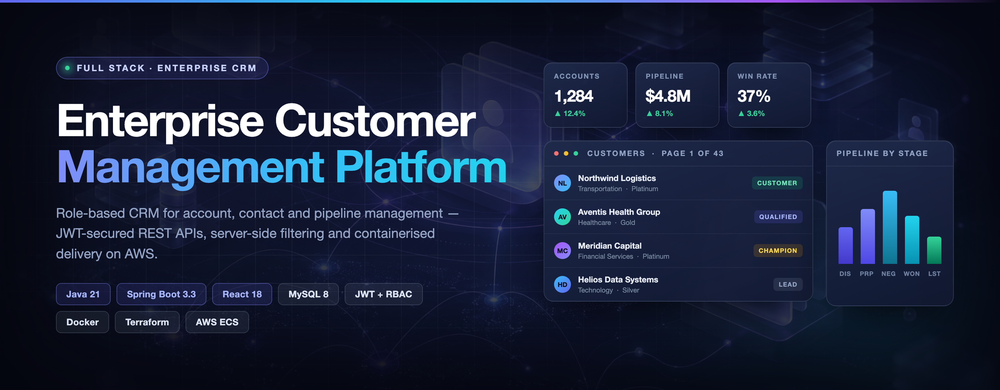
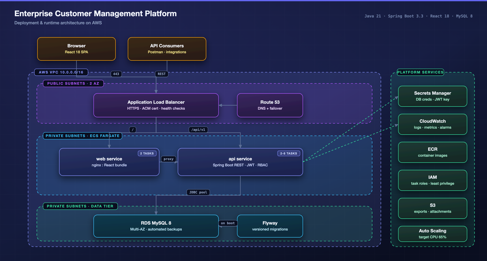
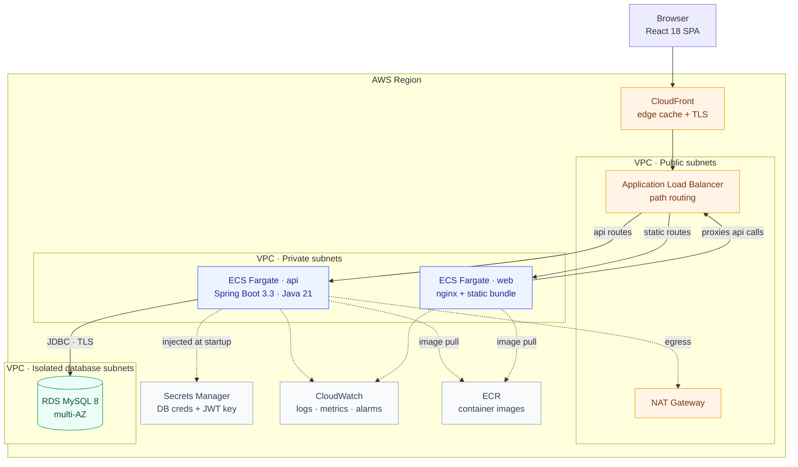
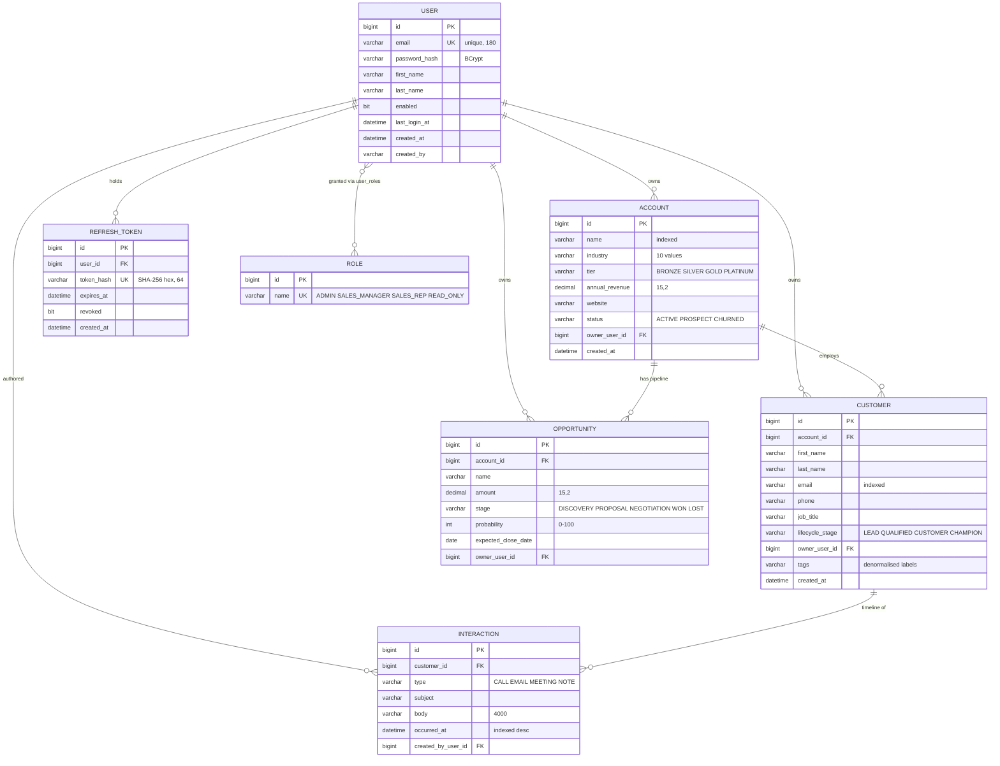
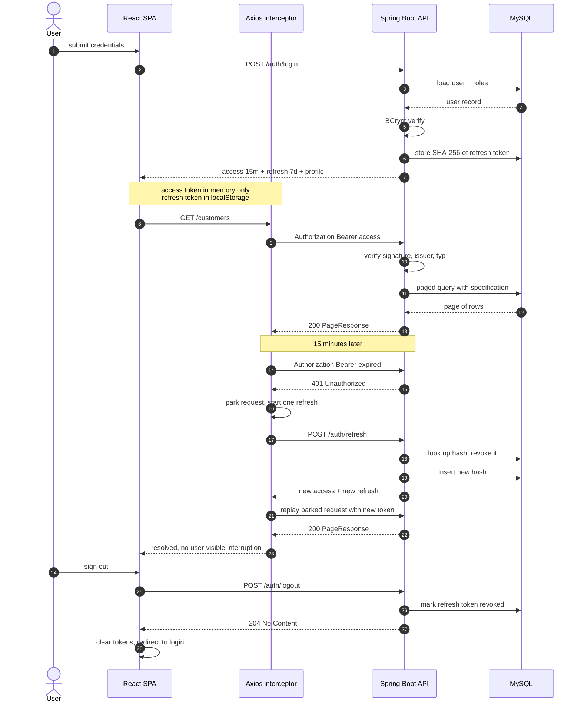
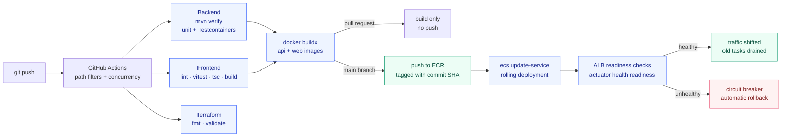

<div align="center">

# Enterprise Customer Management Platform

### A production-shaped B2B CRM — accounts, contacts, pipeline analytics and four-role RBAC — built on Java 21, Spring Boot 3.3 and React 18

[](https://openjdk.org/projects/jdk/21/)
[](https://spring.io/projects/spring-boot)
[](https://react.dev/)
[](https://www.typescriptlang.org/)
[](https://www.mysql.com/)
[](https://docs.docker.com/compose/)
[](https://aws.amazon.com/fargate/)
[](https://developer.hashicorp.com/terraform)
[](../../actions/workflows/ci.yml)
[](LICENSE)

</div>



---

## 📌 Overview

A B2B sales organisation lives on three questions: *who are we selling to, what has been said to
them, and what is the pipeline actually worth?* Most teams answer those questions across a
spreadsheet, an inbox and someone's memory. The numbers disagree, nobody knows which contact is
current, and the forecast is whatever the most confident person in the room says it is.

This platform is the system of record that replaces all three. Companies (**accounts**), the
people inside them (**contacts**), every touchpoint (**interactions**) and every deal
(**opportunities**) live in one relational model with a complete audit trail. Four roles —
administrator, sales manager, sales rep and read-only analyst — get exactly the access they
should, enforced at the endpoint *and* at the row, so a rep can see the whole book of business
but can only change their own. The dashboard answers the pipeline question with database
aggregates rather than a spreadsheet, which is why it stays fast as the dataset grows.

It is built the way a team would build it: Flyway owns the schema and Hibernate validates against
it at boot, every list endpoint is paged and filtered server-side, JWT access tokens are
short-lived with rotating refresh tokens stored only as hashes, the whole thing runs with
`docker compose up`, and the AWS topology is real Terraform rather than a diagram.

---

## ✨ Key Features

| | Feature | What it actually means |
|---|---|---|
| 🏢 | **Account hierarchy** | Accounts are the aggregate root; contacts, deals and interactions all hang off them. Tiered BRONZE→PLATINUM with industry and lifecycle status for segmentation. |
| 🔐 | **RBAC with four roles** | `@PreAuthorize` answers *may this role call this route*; a service-layer ownership check answers *may this user touch this row*. Both are required — same role, different data. |
| 🎫 | **JWT access + refresh rotation** | 15-minute self-contained access tokens (no session store, no database hit per request) and 7-day refresh tokens that rotate on every use and are persisted only as a SHA-256 digest. |
| 📄 | **Server-side pagination & filtering** | Six composable filters on contacts, five on accounts, built with JPA `Specification` so every literal is parameter-bound. Page size capped at 100 server-side. |
| 📊 | **Pipeline analytics** | The whole dashboard is 7 statements — one `GROUP BY` per chart — constant in the size of the dataset, behind a 60-second Caffeine cache. |
| 🧾 | **Audit trail** | `createdBy`/`updatedBy`/timestamps stamped automatically on every entity via `AuditingEntityListener`, plus an append-only interaction timeline per contact. |
| 📘 | **OpenAPI documentation** | Live Swagger UI from springdoc, with the published contract checked in at `docs/api/openapi.yaml` and a working Postman collection with auth flow and assertions. |
| 🐳 | **Containerised** | Multi-stage builds for both tiers: layered-jar extraction on a JRE Alpine base for the API, nginx serving ~1 MB of pre-compressed assets for the SPA. Non-root, health-checked. |
| ☁️ | **Infrastructure as code** | ~1,200 lines of Terraform: three-tier VPC, ALB, two ECS Fargate services on Graviton, RDS MySQL multi-AZ, ECR, Secrets Manager, CloudWatch, autoscaling on two signals. |
| ⚙️ | **CI on every push** | Four filtered jobs — Maven `verify` including Testcontainers integration tests, npm lint/test/build, buildx image builds, `terraform fmt` and `validate`. |

---

## 🏗 System Architecture





**Why this shape.** The SPA and the API sit behind the same load balancer, so the browser only
ever talks to one origin and CORS never enters production. ECS tasks run in private subnets with
no public IP; the database subnets have a route table with no default route at all, which is a
stronger guarantee than a security-group rule. Secrets are injected by the ECS agent at task
start-up, so no credential appears in a task definition or an environment file. Container images
and secrets arrive over PrivateLink rather than the NAT gateway — every deploy pulls an image, and
that traffic is billed per gigabyte through NAT.

---

## 🗂 Data Model

Seven entities. `Account` is the aggregate root; `BaseAuditEntity` contributes the four audit
columns to every table except `roles` and `refresh_tokens`.



---

## 🔑 Authentication Flow



Three details that matter more than they look:

- **One refresh, many waiters.** Concurrent requests that all hit an expired token queue behind a
  single refresh. Without that queue, five parallel 401s would trigger five rotations, each
  revoking the previous one, and the fifth would log the user out — an intermittent bug that is
  miserable to reproduce.
- **Replaying a revoked token revokes the whole chain.** Either the attacker used it and the real
  user's next refresh trips the alarm, or the reverse. Token theft becomes a visible event rather
  than a silent week.
- **403 is never retried.** The caller is authenticated and simply not allowed; a new token
  changes nothing.

---

## 🔁 Request Lifecycle

```mermaid
flowchart LR
    REQ["HTTP request"] --> CORS["CORS filter<br/>origin allowlist"]
    CORS --> JWT["JwtAuthenticationFilter<br/>parse bearer, build principal"]
    JWT --> AUTHZ{"authenticated?"}
    AUTHZ -->|no| P401["401 ProblemDetail"]
    AUTHZ -->|yes| CTRL["Controller<br/>PreAuthorize role check"]
    CTRL -->|wrong role| P403["403 ProblemDetail"]
    CTRL --> VAL{"bean validation"}
    VAL -->|invalid| P400["400 ProblemDetail<br/>per-field errors"]
    VAL -->|valid| SVC["Service<br/>transaction boundary"]
    SVC --> OWN{"owns the record?"}
    OWN -->|"no and not a manager"| P403
    OWN -->|yes| SPEC["Specification<br/>compose predicates"]
    SPEC --> REPO["Repository<br/>entity graph + Pageable"]
    REPO --> SQL[("MySQL 8<br/>composite indexes")]
    SQL --> MAP["MapStruct<br/>entity to DTO record"]
    MAP --> RESP["200 PageResponse"]

    classDef ok fill:#ecfdf5,stroke:#059669,color:#064e3b
    classDef err fill:#fef2f2,stroke:#e11d48,color:#7f1d1d
    classDef work fill:#eef4ff,stroke:#325dff,color:#1a298f

    class RESP,SQL ok
    class P400,P401,P403 err
    class CORS,JWT,CTRL,SVC,SPEC,REPO,MAP work
```



Every error branch produces the same RFC 7807 `application/problem+json` shape from a single
`@RestControllerAdvice`, so the client has exactly one error parser and a stable `type` URI to
switch on.

---

## 🧰 Tech Stack

| Layer | Technology | Why this one |
|---|---|---|
| **Frontend** | React 18 + TypeScript 5.6 | Strict types across the API boundary; `strict` plus `noUnusedLocals` catches contract drift at build time |
| | Vite 5 | Sub-second HMR, and a `/api` dev proxy so local development is same-origin exactly like production |
| | TanStack Query 5 | Server state is cache state — paged slices keyed by filter, request dedup, and one place to define retry policy |
| | React Hook Form + Zod | Uncontrolled inputs mean no re-render per keystroke; the Zod schema mirrors the server's validation field for field |
| | Tailwind CSS 3 | Design tokens in one config file; no stylesheet drifts away from the component that uses it |
| | Recharts | Composable SVG charts that respond to container width without a wrapper library |
| **Backend** | Java 21 | Records for DTOs, pattern matching, and virtual threads for IO-bound request handling |
| | Spring Boot 3.3.4 | Actuator probes, `@Transactional` boundaries and method security without assembling them by hand |
| | Spring Security 6 | Stateless filter chain plus `@EnableMethodSecurity` for per-handler role rules |
| | JJWT 0.12 | Explicit, modern API — `verifyWith`, `requireIssuer`, typed claims — with no reflection at runtime |
| | Spring Data JPA | `Specification` for composable filters, `Pageable` for paging, interface projections for aggregates |
| | MapStruct 1.6 | Compile-time mapping: no reflection on the hot path, and a renamed field breaks the build rather than returning null |
| | Caffeine | In-process cache with per-cache TTLs; no network hop to save a query that takes 3 ms |
| | springdoc-openapi 2.6 | Documentation generated from the code that serves the requests, so it cannot go stale |
| **Data** | MySQL 8.0 | Composite and descending indexes, window functions, `utf8mb4` throughout |
| | Flyway | Migrations are the source of truth and Hibernate runs `ddl-auto: validate` — a mapping/schema mismatch fails at boot, not at 3 a.m. |
| | HikariCP | Pool sized deliberately (`(2 × cores) + spindles`) so queueing happens where it is observable |
| **Testing** | JUnit 5 + Mockito | Ownership rules unit-tested with a stubbed principal, no Spring context |
| | Testcontainers | Integration tests run against real MySQL 8 and the real migrations — H2 would not validate the production DDL |
| | Vitest + Testing Library | Component tests that assert behaviour and accessible names, not implementation details |
| **DevOps** | Docker multi-stage | Layered-jar extraction, so a redeploy pushes kilobytes instead of a 60 MB fat jar |
| | nginx 1.27 | SPA history fallback, gzip, immutable asset caching and the `/api` reverse proxy |
| | GitHub Actions | Path-filtered jobs with a concurrency group, so a superseded push is cancelled |
| **Cloud** | ECS Fargate (Graviton) | No servers to patch; ARM64 is cheaper per vCPU and the JVM runs well on it |
| | RDS MySQL multi-AZ | Synchronous standby, automated backups, Performance Insights |
| | ALB | Path-based routing to two target groups, so one origin serves both tiers |
| | Secrets Manager | Credentials injected at task start-up, never in an image or a repository |
| | Terraform 1.9 | The topology is reviewable in a pull request and reproducible in another region |

---

## 📁 Project Structure

```
enterprise-customer-management-platform/
├── backend/                                  # Spring Boot 3.3 · Java 21 · Maven
│   ├── src/main/java/com/akhilanga/crm/
│   │   ├── CrmApplication.java               # entry point; enables auditing + caching
│   │   ├── config/                           # JwtProperties, CacheConfig, JpaAuditingConfig, OpenApiConfig
│   │   ├── security/                         # JwtService, filter, SecurityConfig, principal, CurrentUserProvider
│   │   ├── domain/                           # 7 JPA entities + BaseAuditEntity; enums nested per aggregate
│   │   ├── repository/                       # Spring Data interfaces + aggregate projections
│   │   ├── specification/                    # composable Criteria filters for accounts and customers
│   │   ├── service/                          # use cases, transactions, ownership enforcement
│   │   ├── mapper/                           # MapStruct entity to DTO mappers
│   │   ├── web/                              # REST controllers with @PreAuthorize
│   │   │   └── dto/                          # request/response records with jakarta.validation
│   │   └── exception/                        # GlobalExceptionHandler + RFC 7807 problem types
│   ├── src/main/resources/
│   │   ├── application.yml                   # env-var driven; ddl-auto validate, open-in-view false
│   │   ├── application-docker.yml            # container profile
│   │   └── db/migration/                     # V1 core schema (indexes explained), V2 seed data
│   ├── src/test/java/com/akhilanga/crm/      # JwtServiceTest, CustomerServiceTest, CustomerControllerIT
│   ├── Dockerfile                            # multi-stage, layered jar, non-root, HEALTHCHECK
│   └── pom.xml                               # Lombok before MapStruct in the processor path
│
├── frontend/                                 # React 18 · TypeScript · Vite
│   ├── src/
│   │   ├── api/                              # axios instance with silent refresh + queue; module per resource
│   │   ├── types/                            # hand-written API contract types
│   │   ├── context/AuthContext.tsx            # session state, silent restore on reload
│   │   ├── hooks/                            # useDebounce, formatters
│   │   ├── components/ui/                    # Primitives, Table, Pagination, Modal/Drawer, Toast
│   │   ├── components/layout/                # AppShell, Sidebar, Topbar, ProtectedRoute, RoleGate
│   │   ├── features/                         # auth · dashboard · accounts · customers · opportunities · interactions · settings
│   │   ├── App.tsx                           # route table
│   │   └── main.tsx                          # providers + React Query defaults
│   ├── Dockerfile                            # node build stage to nginx runtime
│   ├── nginx.conf                            # SPA fallback, gzip, immutable assets, /api proxy
│   └── package.json
│
├── deploy/terraform/                         # AWS infrastructure as code
│   ├── main.tf        vpc.tf      alb.tf     # cluster, logs, alarms · 3-tier network · load balancer
│   ├── ecs.tf         rds.tf      ecr.tf     # task definitions + autoscaling · MySQL · registries
│   ├── secrets.tf     variables.tf outputs.tf
│   └── README.md                             # design notes, cost breakdown, teardown
│
├── .github/workflows/ci.yml                  # backend · frontend · docker · terraform
├── docs/
│   ├── ARCHITECTURE.md                       # bounded contexts, layering, trade-offs, scaling path
│   ├── SCREENSHOTS.md                        # annotated walkthrough
│   └── api/openapi.yaml                      # published OpenAPI 3.0 contract
├── postman/CRM.postman_collection.json       # auth flow + assertions + RBAC checks
├── docker-compose.yml                        # mysql (healthcheck) → api → web
├── .env.example                              # every environment variable, documented
├── CONTRIBUTING.md
└── LICENSE
```

---

## 🚀 Getting Started

### Prerequisites

| Tool | Version | Needed for |
|---|---|---|
| Docker + Compose | 24+ / v2 | the whole stack in one command |
| Java (JDK) | 21 | running the API without Docker |
| Maven | 3.9+ | building and testing the API locally |
| Node.js | 20+ (22 recommended) | running the SPA without Docker |
| MySQL | 8.0 | only if you skip Docker entirely |

### Run everything

```bash
git clone https://github.com/Akhil-Anga/enterprise-customer-management-platform.git
cd enterprise-customer-management-platform

cp .env.example .env          # sensible local defaults; change JWT_SECRET for anything real
docker compose up --build
```

First boot takes a couple of minutes: Maven resolves dependencies, npm builds the bundle, MySQL
initialises, then Flyway applies both migrations and seeds the demo data. The API waits for
MySQL's health check rather than just its container start, so you will not see a
connection-refused race.

| Service | URL |
|---|---|
| Web application | <http://localhost:3000> |
| REST API | <http://localhost:8080/api/v1> |
| Swagger UI | <http://localhost:8080/swagger-ui.html> |
| OpenAPI JSON | <http://localhost:8080/v3/api-docs> |
| Actuator health | <http://localhost:8080/actuator/health> |

### Demo credentials

Seeded by `V2__seed_reference_data.sql`. The login screen has a one-click button for each.

| Role | Email | Password | Can do |
|---|---|---|---|
| **ADMIN** | `admin@akhilcrm.io` | `Admin@12345` | everything, including user administration |
| **SALES_MANAGER** | `manager@akhilcrm.io` | `Manager@12345` | read and write every record, reassign ownership |
| **SALES_REP** | `rep@akhilcrm.io` | `Rep@12345` | read everything, write only records they own |
| **READ_ONLY** | `viewer@akhilcrm.io` | `ReadOnly@12345` | GET only — every write returns 403 |

Sign in as the rep and then as the manager to see the ownership rule bite: both can see every
contact, only one can edit all of them.

### Running locally without Docker

<details>
<summary><b>Backend</b></summary>

```bash
# A MySQL 8 instance is all the API needs from Docker
docker run -d --name crm-mysql -p 3306:3306 \
  -e MYSQL_ROOT_PASSWORD=root_password \
  -e MYSQL_DATABASE=crm \
  -e MYSQL_USER=crm_app \
  -e MYSQL_PASSWORD=crm_app_password \
  mysql:8.0

cd backend
export DB_HOST=localhost DB_USERNAME=crm_app DB_PASSWORD=crm_app_password
export JWT_SECRET=local-development-only-secret-please-override-with-32-plus-chars

mvn spring-boot:run
```

Flyway migrates on start-up and Hibernate validates the mapping against the result, so a
mismatch between an entity and a migration fails the boot with the offending column named.
</details>

<details>
<summary><b>Frontend</b></summary>

```bash
cd frontend
npm install
npm run dev          # http://localhost:5173, proxying /api to :8080
```

The Vite dev server proxies `/api` and `/actuator` to `localhost:8080`, so development is
same-origin exactly like production and CORS never appears in the local feedback loop.
</details>

---

## 📡 API Reference

All paths are prefixed `/api/v1`. Every endpoint except `/auth/login`, `/auth/refresh` and
`/auth/logout` requires `Authorization: Bearer <accessToken>`.

| Method | Path | Role required | Description |
|---|---|---|---|
| `POST` | `/auth/login` | — | Exchange credentials for an access + refresh pair |
| `POST` | `/auth/refresh` | — | Rotate a refresh token; the presented one is revoked |
| `POST` | `/auth/logout` | — | Revoke a refresh token (idempotent) |
| `GET` | `/auth/me` | any | Current user, roles and last login |
| `GET` | `/accounts` | any | Paged, sorted, filtered account list |
| `POST` | `/accounts` | ADMIN, MANAGER, REP | Create an account |
| `GET` | `/accounts/{id}` | any | One account with contact and pipeline counts |
| `PUT` | `/accounts/{id}` | ADMIN, MANAGER, REP¹ | Replace an account |
| `PUT` | `/accounts/{id}/owner` | ADMIN, MANAGER | Transfer ownership |
| `DELETE` | `/accounts/{id}` | ADMIN, MANAGER | Delete — refused while children remain |
| `GET` | `/customers` | any | Paged contact list; filter by stage, account, owner, tag, tier |
| `POST` | `/customers` | ADMIN, MANAGER, REP | Create a contact |
| `GET` | `/customers/{id}` | any | One contact |
| `PUT` | `/customers/{id}` | ADMIN, MANAGER, REP¹ | Replace a contact |
| `PATCH` | `/customers/{id}` | ADMIN, MANAGER, REP¹ | Partial update for inline edits |
| `PUT` | `/customers/{id}/owner` | ADMIN, MANAGER | Transfer ownership |
| `DELETE` | `/customers/{id}` | ADMIN, MANAGER, REP¹ | Delete a contact and its trail |
| `GET` | `/interactions` | any | Timeline, optionally scoped to a contact or account |
| `POST` | `/interactions` | ADMIN, MANAGER, REP | Log an activity; the caller is the author |
| `DELETE` | `/interactions/{id}` | author, MANAGER, ADMIN | Remove an entry |
| `GET` | `/opportunities` | any | Paged deal list |
| `GET` | `/opportunities/board` | any | Deals grouped by stage for the kanban board |
| `POST` | `/opportunities` | ADMIN, MANAGER, REP | Create a deal |
| `PUT` | `/opportunities/{id}` | ADMIN, MANAGER, REP¹ | Replace a deal |
| `PATCH` | `/opportunities/{id}/stage` | ADMIN, MANAGER, REP¹ | Move stage; WON/LOST pin probability |
| `DELETE` | `/opportunities/{id}` | ADMIN, MANAGER | Delete a deal |
| `GET` | `/dashboard/summary` | any | KPI bundle from aggregate queries |
| `GET` | `/users` | ADMIN | Paged user directory |
| `POST` | `/users` | ADMIN | Create a user, assign roles |
| `PUT` | `/users/{id}` | ADMIN | Update profile/roles; revokes refresh tokens |
| `GET` | `/users/options` | any | Owner-picker options (cached reference data) |

¹ SALES_REP additionally has to own the record. Failing that check returns `403` with
`type: https://docs.akhilcrm.io/problems/ownership-required`.

### Sign in

```bash
curl -s -X POST http://localhost:8080/api/v1/auth/login \
  -H 'Content-Type: application/json' \
  -d '{"email":"admin@akhilcrm.io","password":"Admin@12345"}'
```

```json
{
  "accessToken": "eyJhbGciOiJIUzI1NiJ9.eyJqdGkiOiI3YTNm...",
  "refreshToken": "eyJhbGciOiJIUzI1NiJ9.eyJqdGkiOiJjOTE4...",
  "tokenType": "Bearer",
  "expiresIn": 900,
  "user": {
    "id": 1,
    "email": "admin@akhilcrm.io",
    "firstName": "Akhil",
    "lastName": "Anga",
    "roles": ["ADMIN"],
    "lastLoginAt": "2026-09-17T09:14:02.118Z"
  }
}
```

### Create a contact

```bash
TOKEN=$(curl -s -X POST http://localhost:8080/api/v1/auth/login \
  -H 'Content-Type: application/json' \
  -d '{"email":"manager@akhilcrm.io","password":"Manager@12345"}' \
  | python3 -c 'import json,sys; print(json.load(sys.stdin)["accessToken"])')

curl -s -X POST http://localhost:8080/api/v1/customers \
  -H "Authorization: Bearer $TOKEN" \
  -H 'Content-Type: application/json' \
  -d '{
        "accountId": 1,
        "firstName": "Nina",
        "lastName": "Okafor",
        "email": "nina.okafor@northwind-logistics.example.com",
        "phone": "+1-716-555-0164",
        "jobTitle": "Director of Procurement",
        "lifecycleStage": "QUALIFIED",
        "tags": "inbound, budget-holder"
      }'
```

```json
{
  "id": 7,
  "accountId": 1,
  "accountName": "Northwind Logistics",
  "firstName": "Nina",
  "lastName": "Okafor",
  "email": "nina.okafor@northwind-logistics.example.com",
  "phone": "+1-716-555-0164",
  "jobTitle": "Director of Procurement",
  "lifecycleStage": "QUALIFIED",
  "ownerUserId": 2,
  "ownerName": "Dana Whitfield",
  "tags": "inbound, budget-holder",
  "createdAt": "2026-09-17T09:16:44.902Z",
  "updatedAt": "2026-09-17T09:16:44.902Z"
}
```

### Paged, filtered list

```bash
curl -s -G http://localhost:8080/api/v1/customers \
  -H "Authorization: Bearer $TOKEN" \
  --data-urlencode 'search=fischer' \
  --data-urlencode 'stage=CHAMPION' \
  --data-urlencode 'page=0' \
  --data-urlencode 'size=20' \
  --data-urlencode 'sort=lastName,asc'
```

```json
{
  "content": [
    {
      "id": 1,
      "accountId": 1,
      "accountName": "Northwind Logistics",
      "firstName": "Elena",
      "lastName": "Fischer",
      "email": "elena.fischer@northwind-logistics.example.com",
      "phone": "+1-716-555-0142",
      "jobTitle": "VP Operations",
      "lifecycleStage": "CHAMPION",
      "ownerUserId": 2,
      "ownerName": "Dana Whitfield",
      "tags": "decision-maker,renewal",
      "createdAt": "2026-09-17T08:55:01.004Z",
      "updatedAt": "2026-09-17T08:55:01.004Z"
    }
  ],
  "page": 0,
  "size": 20,
  "totalElements": 1,
  "totalPages": 1,
  "first": true,
  "last": true
}
```

A validation failure returns the same problem-document shape everywhere:

```json
{
  "type": "https://docs.akhilcrm.io/problems/validation-error",
  "title": "Validation failed",
  "status": 400,
  "detail": "One or more fields are invalid. See the errors member for details.",
  "instance": "/api/v1/customers",
  "timestamp": "2026-09-17T09:18:10.551Z",
  "errors": {
    "email": "must be a well-formed email address",
    "firstName": "must not be blank"
  }
}
```

---

## 🧪 Testing

| Suite | Tool | Covers |
|---|---|---|
| `JwtServiceTest` | JUnit 5 | Claim contents, both TTLs, expiry with an injected clock, cross-type replay rejection, foreign-signature rejection, digest stability |
| `CustomerServiceTest` | JUnit 5 + Mockito | The ownership matrix: rep on own record, rep on another's, manager bypass, delete guard, reassignment gate, duplicate email, unknown account |
| `CustomerControllerIT` | `@SpringBootTest` + Testcontainers MySQL + MockMvc | 401 without a token, malformed token, login and the token pair, generic bad-credentials message, page envelope, case-insensitive search, stage filter, page-size clamping, READ_ONLY read vs 403 write, admin-only route, itemised validation errors, 404 shape |
| `Pagination.test.tsx` | Vitest + Testing Library | Window/ellipsis arithmetic, first/last-page disabled states, zero-based emission, `aria-current`, empty-set range, page-size change |
| `LoginPage.test.tsx` | Vitest + Testing Library | Field rendering, empty-form validation, malformed email, credentials passed to `login`, API error surfaced via `role="alert"`, demo-persona autofill |

```bash
# Backend: unit tests (Surefire) then Testcontainers integration tests (Failsafe)
cd backend && mvn -B verify

# Just the fast unit tests
mvn -B test

# Frontend
cd frontend && npm run test
npm run lint
npm run build          # tsc --noEmit then a production bundle
```

The integration test runs against **real MySQL 8 and the real migrations**. An H2 substitute would
start faster and prove nothing: it would not validate the production DDL, would not exercise the
`ddl-auto: validate` contract that protects every boot, and would not reproduce MySQL's collation
behaviour in the case-insensitive search. Docker has to be running.

---

## ⚡ Performance & Optimization Notes

Each of these is a decision with a reason, not a setting copied from a blog post.

**Composite indexes follow the query, not the column.** `idx_customers_account_stage` on
`(account_id, lifecycle_stage)` serves the hottest query in the product — the contacts tab of an
account, funnel-filtered — and because `account_id` leads, the same index also serves the
unfiltered tab. `idx_customers_owner_stage` makes the SALES_REP scope filter index-only.
`idx_interactions_customer_occurred` is declared `(customer_id, occurred_at DESC)`, which lets
MySQL 8 satisfy the newest-first timeline with no filesort at all. Every index in
`V1__core_schema.sql` carries a comment naming the query it exists for; an index without a query
is just write amplification.

**`open-in-view: false`.** The single most valuable line in `application.yml`. With it off, the
Hibernate session closes when the service method returns, so no lazy association can be touched
during JSON serialisation. That converts a class of invisible production N+1 — queries issued
during rendering, on a connection already returned to the pool — into a
`LazyInitializationException` at development time, which is a bug you can actually fix.

**Batch fetching kills the N+1 that survives.** `default_batch_fetch_size: 25` makes Hibernate
load lazy associations for 25 parents at a time with an `IN (...)`, turning N queries into N/25.
The read paths go further: `@EntityGraph(attributePaths = {"account", "ownerUser"})` on the
specification `findAll` joins the associations into the same statement, so a 25-row contact page
is **one** query rather than 51. `in_clause_parameter_padding` rounds `IN` list sizes to powers of
two so the query plan cache is not polluted by one entry per list length.

**The dashboard is one aggregate per widget.** Seven statements serve the entire screen — one
`GROUP BY` for pipeline value by stage, one for the contact funnel, one for the activity mix, one
`ORDER BY … LIMIT` for top accounts, and three index-only counts. That number is *constant* in
the size of the dataset. The naive version iterates the stage enum issuing a `SUM` per stage, or
worse loads every open deal and folds it in the JVM; both grow with the data and the second moves
the whole pipeline table over the wire.

**Caffeine with per-cache TTLs.** The dashboard summary is cached for 60 seconds and reference
lookups for 30 minutes, because they change at completely different rates. Sixty seconds is
invisible to a human reading revenue figures and it collapses the morning login stampede into one
database round trip per minute per instance. In-process rather than Redis is the right call at
this size: the payloads are kilobytes and a network hop would cost more than the query it
replaces. The trade-off accepted is up to 60 seconds of divergence between instances on KPI
tiles — which is why nothing transactional is cached.

**Pagination is capped server-side.** `spring.data.web.pageable.max-page-size: 100` means
`?size=5000` silently becomes 100. A client cannot ask for the whole table, by accident or
otherwise, and an unbounded list endpoint is the classic way a fast application becomes a slow one
after a year of data growth.

**HikariCP sized on purpose.** Ten connections per instance locally, fifteen in the ECS task
definition, following `(2 × cores) + effective spindles`. A bigger pool does not make MySQL
faster; it just moves the queue from the application, where it is visible in metrics, into the
database, where it is not. The RDS connection alarm is set below `api_max_capacity × DB_POOL_MAX`
so saturation is caught before connections are refused.

**Counts come from aggregates, never from collections.** `AccountDtos.Response.withCounts()`
takes two `COUNT` results. Mapping a `@OneToMany` to produce those numbers would load every child
row to print an integer — and the account detail page pays that cost for one account, while the
list endpoint deliberately skips the counts entirely rather than turning a 25-row page into 51
queries.

**Front end: gzip plus immutable assets.** nginx gzips JSON and JS above 1 KB. Vite fingerprints
every file under `/assets`, so the content at a URL can never change — they are served
`max-age=31536000, immutable`, while `index.html` is `no-store` because it is the document that
points at the current hashes. A stale `index.html` would load a bundle that no longer exists.
Vendor chunks are split from application code, so a UI tweak does not invalidate React in a
returning user's cache.

**Debounced search, deduplicated queries.** The contact search debounces at 300 ms, below the
threshold where typing feels laggy and above the interval between keystrokes. TanStack Query keys
each paged slice by its full filter set, so going back a page is instant and identical concurrent
requests are deduplicated; `placeholderData` keeps the previous page rendered while the next one
loads instead of collapsing the table to a skeleton.

**Layered container images.** The Dockerfile extracts the Spring Boot jar into its layer
directories, ordered least-volatile first. Dependencies change far less often than application
classes, so a redeploy pushes a few hundred kilobytes rather than a 60 MB fat jar. The JVM uses
`MaxRAMPercentage` instead of a fixed `-Xmx`, so it respects whatever the ECS task grants without
the image knowing the number.

---

## 🔒 Security

**Password storage.** BCrypt via `BCryptPasswordEncoder(12)` — roughly 250 ms per hash on current
hardware, which keeps online brute force impractical while staying inside the login endpoint's
latency budget. Cost is a constructor argument precisely so it can be raised as hardware gets
faster; the encoder verifies hashes at any cost, so the seeded demo credentials (generated at
cost 10) keep working.

**Short-lived access tokens.** 15 minutes, HS256, held in browser **memory only**. A
`localStorage` copy would survive an XSS payload; memory does not. The cost is that a reload loses
it, which is exactly what the refresh token is for.

**Rotating refresh tokens, stored hashed.** Only `SHA-256(token)` is persisted, so a database
dump cannot be replayed as a session. Every refresh revokes the presented token and issues a new
one, so a stolen token works at most once — and presenting an already-revoked token revokes the
entire chain for that user, turning theft into a detectable event. The `typ` claim is asserted on
parse, so an access token can never be exchanged at `/auth/refresh` and a refresh token can never
be used as a bearer credential.

**Authorization at two levels.** `@PreAuthorize` on handlers for the role; an ownership comparison
in the service for the row. Both are needed, because every SALES_REP holds an identical authority
and only the service has the row in hand. A role change calls `revokeAllForUser`, so a demoted
user cannot keep old permissions until their access token expires. The UI hides controls a role
cannot use, but that is courtesy — the API refuses regardless.

**No self-lockout.** An admin cannot disable themselves or remove their own ADMIN role, because an
installation with no administrator is unrecoverable through the product.

**CORS allowlist, not a wildcard.** Explicit origins from `CORS_ALLOWED_ORIGINS`, applied only to
`/api/**`, with credentials allowed. In production the SPA and the API share an origin behind the
ALB, so CORS is only exercised by the dev server. The nginx same-origin proxy omits the browser's
`Origin` header when forwarding `/api/` requests; direct browser clients calling the API still need
their exact origin listed in `CORS_ALLOWED_ORIGINS`.

**No CSRF token, deliberately.** The session is a bearer header that a cross-site form post cannot
set, and there is no cookie to ride. A CSRF token here would add an exchange without adding
safety. This is a consequence of the stateless design, not an oversight.

**Secrets in Secrets Manager, not in environment files.** Terraform generates the database
password and the JWT key with `random_password` and the ECS agent injects them at task start-up
via the task definition's `secrets` block — so no credential appears in an image, a task
definition, the ECS console or the repository. `.env` is git-ignored and only `.env.example`, which
contains placeholders, is committed. The honest trade-off: generated values do live in Terraform
state, which is why the state bucket is encrypted and access-controlled and is the most sensitive
artifact in the stack.

**SQL injection is structurally impossible.** Every query is either a derived Spring Data method,
a `@Query` with named parameters, or a Criteria `Specification` — all of which bind values as JDBC
parameters. There is no string concatenation anywhere in the data access layer, which is the main
reason the dynamic filter is built with `Specification` rather than an assembled JPQL string.

**Defence in depth on inputs.** `jakarta.validation` on every request record (lengths matching the
column definitions exactly, email format, phone pattern, `@PastOrPresent` on interaction
timestamps, `0..100` on probability), a `CHECK` constraint in the schema as a backstop, and a Zod
schema on the client that mirrors the server rules so mistakes are caught before a round trip.

**Security headers.** `X-Content-Type-Options: nosniff`, `X-Frame-Options: DENY`,
`Referrer-Policy: strict-origin-when-cross-origin`, HSTS with `includeSubDomains` for a year, and
`Permissions-Policy` denying geolocation, microphone and camera — set by Spring Security on API
responses and by nginx on static ones.

**Least-privilege infrastructure.** Two IAM roles: the ECS execution role pulls images and reads
exactly the two secrets this stack owns (not `secretsmanager:*`), while the task role the
application runs as holds no Secrets Manager permission at all. Security groups reference each
other rather than CIDR ranges, the database subnets have no route to the internet, and the ALB's
egress is restricted to the VPC.

**Errors that do not leak.** A wrong password and an unknown email return the identical
`Invalid credentials.` message, because distinguishing them is a user-enumeration oracle.
`server.error.include-stacktrace: never`, and the fallback handler logs the exception while
returning only "the incident has been logged".

---

## 🚢 Deployment

### AWS topology

- **VPC** with three subnet tiers per AZ: public (ALB, NAT), private (ECS tasks), and isolated
  database subnets whose route table has no default route at all.
- **ALB** with path-based routing — `/api/*`, `/swagger-ui*`, `/actuator/health*` to the API target
  group, everything else to nginx — so the browser sees one origin. TLS 1.2 floor, HTTP redirects
  to HTTPS when a certificate is supplied.
- **Two ECS Fargate services on Graviton (ARM64).** The API is on-demand with CPU and
  request-count autoscaling from 2 to 8 tasks; the stateless web tier runs one on-demand task plus
  a 3:1 Fargate Spot weighting for roughly a 70% saving on that tier.
- **RDS MySQL 8 multi-AZ** in the isolated subnets, gp3 storage with autoscaling, encrypted at
  rest, 7-day automated backups, Performance Insights and a slow-query log at 500 ms.
- **ECR** with scan-on-push and lifecycle policies; **Secrets Manager** for the database
  credentials and the JWT key; **CloudWatch** log groups with retention plus alarms on API 5xx and
  RDS connection saturation.
- **PrivateLink endpoints** for ECR, S3, Secrets Manager and Logs, so image pulls and secret reads
  never traverse the NAT gateway.
- **Deployment circuit breaker with automatic rollback**, and
  `deployment_minimum_healthy_percent = 100`, so a bad deploy never reduces serving capacity.

```bash
cd deploy/terraform
cp terraform.tfvars.example terraform.tfvars

terraform init
terraform fmt -check -recursive
terraform validate
terraform plan -out=tfplan
terraform apply tfplan

# then push images and roll the services
terraform output -raw ecr_api_repository_url
terraform output -raw application_url
```

Images must be built `--platform linux/arm64`; both task definitions request Graviton. Full
walkthrough, design notes and a cost breakdown are in
[`deploy/terraform/README.md`](deploy/terraform/README.md).

### CI/CD pipeline



Path filters mean a Terraform-only change does not rebuild the Java, and the concurrency group
cancels a run that a newer push has already superseded. Pull requests build both images to prove
the Dockerfiles still work, but never push.

---

## 🗺 Roadmap

- [ ] **Email and calendar sync** — ingest Gmail and Outlook threads into the interaction timeline
      so activity is captured without anyone typing it
- [ ] **True multi-tenancy** — `tenant_id` on every table with a Hibernate filter applied from the
      JWT, replacing the current per-user ownership boundary
- [ ] **Forecast reporting** — quota attainment per rep, stage conversion rates and
      period-over-period pipeline movement, served from materialised rollups
- [ ] **Bulk CSV import/export** with server-side validation, dry-run preview and a per-row error
      report
- [ ] **Full-text contact search** via a MySQL `FULLTEXT` index, or OpenSearch once fuzzy matching
      and relevance ranking are wanted
- [ ] **Webhooks and an outbox** — publish domain events on stage changes so downstream systems
      react without polling
- [ ] **Read-replica routing** for the analytics endpoints, keeping dashboard traffic off the
      primary

---

## 👤 Author

**Venkata Sai Akhil Anga**
Full Stack Developer · Buffalo, NY

[](https://github.com/Akhil-Anga)
[](mailto:venkatasaiakhilanga@gmail.com)

Five years building production Java and React systems. This project is a deliberate end-to-end
demonstration: domain modelling and migrations, layered Spring Boot with real authorization, a
typed React front end with proper server-state handling, and the infrastructure to run it — with
the reasoning written down rather than assumed. Further reading:
[`docs/ARCHITECTURE.md`](docs/ARCHITECTURE.md) for the trade-offs and
[`docs/SCREENSHOTS.md`](docs/SCREENSHOTS.md) for a walkthrough of the interface.

---

Licensed under the [MIT License](LICENSE) · © 2026 Venkata Sai Akhil Anga
